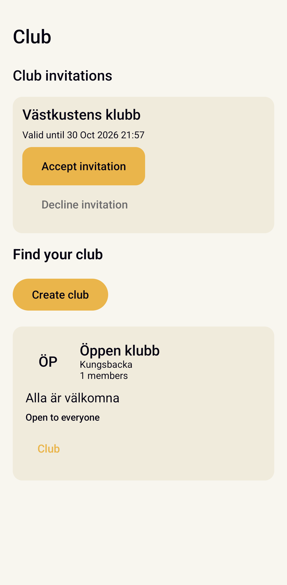

# Chat drafts and club invitations: Android verification

Date: 2026-10-30. Android-only bugfixes, based on main `af2e14e`.
No version change, signed release, Play upload, or iOS modification.

## Verified locally

- The initial invitation integration passed 4,070 JVM tests, with no failures/errors
  and one pre-existing skipped test, plus lintDebug and debug/instrumentation builds.
- The combined chat `2614d80` and invitation UI `c355e99` integration passed 603
  relevant JVM tests (no failures/errors, one existing skip), lintDebug and both
  debug/instrumentation builds. This includes all 36 new chat acknowledgement
  regressions with the real Compose composers under Robolectric.
- Installed those debug/test APKs on an API 34 emulator. All five
  `ClubInvitationFlowTest` cases passed: arrival on an already-open page, decline,
  accept from a selected public-club view, preserving a failed response, preventing
  duplicate actions while pending, respecting the join cooldown, and inbox tap
  navigation/read marking. The crash buffer was empty afterward.
- The owned emulator was shut down after verification.
- Seven producer/writer/backfill tests also passed with the real Firestore SDK on
  a loopback emulator using demo-test and the repository no-cloud transport guard.
  This includes atomic inbox/receipt commits, duplicate/replay suppression,
  preference changes and consent/status changes. Auth was a fixture.

## Screenshot

Captured from the installed Android app during the invitation arrival test.
The account, clubs and invitations are repository fakes; no production data or
Firebase connection was used. The emulator locale is English, and Swedish club
names are fixture content. Both actions remain visible when the buttons wrap.

## Evidence boundaries

These tests prove the Android UI and callback wiring, not real device FCM delivery
or two-account acceptance against production. Shared backend transactions are
verified separately against a loopback Firestore emulator; deployment and actual
notification delivery must be recorded separately. A new Android release is
required to ship the updated UI to users.
