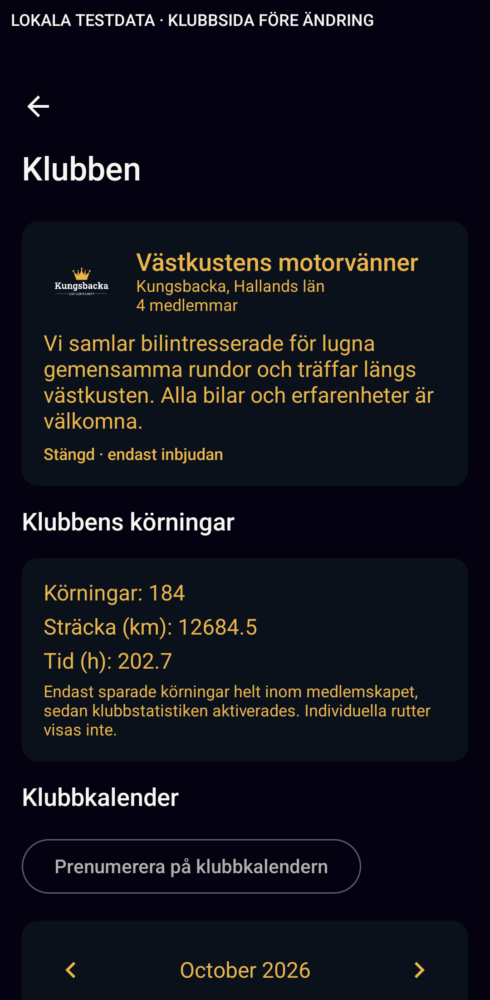
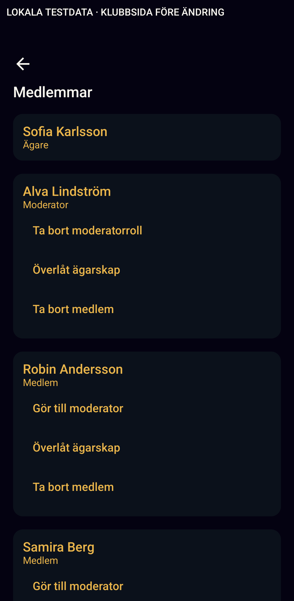

# Club page evidence

Local fixture data only, native production SharedClubRoute, source baseline
6756e8f. Two representative accepted baseline images are committed here;
the complete ten-image baseline was inspected at the parent-provided Downloads
location recorded in ../../club-page-structure-audit.md. The rejected first-run
light identity image is not evidence. Parent recovered a cold-boot System UI ANR
before the successful one-test native capture run.

- before-identity-dark.png: gold reading text across identity and statistics.
- before-members-dark.png: no avatars, persistent per-member management rows.

After implementation, the capture fixture still calls the actual production
route and uses a neutral local-test-data banner. Use a fresh clubPageCaptureRun
such as after-20261030 to keep captures separate; light/dark and font-scale
arguments remain available. Parent owns builds, native tests and screenshots.
Add only the matched after identity/member images after inspection (four PNGs
in total), and record actual QA outcomes; no after evidence or pass is claimed yet.
