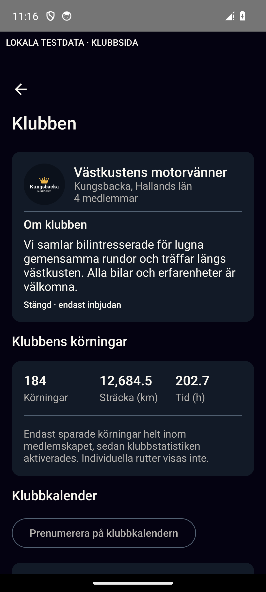
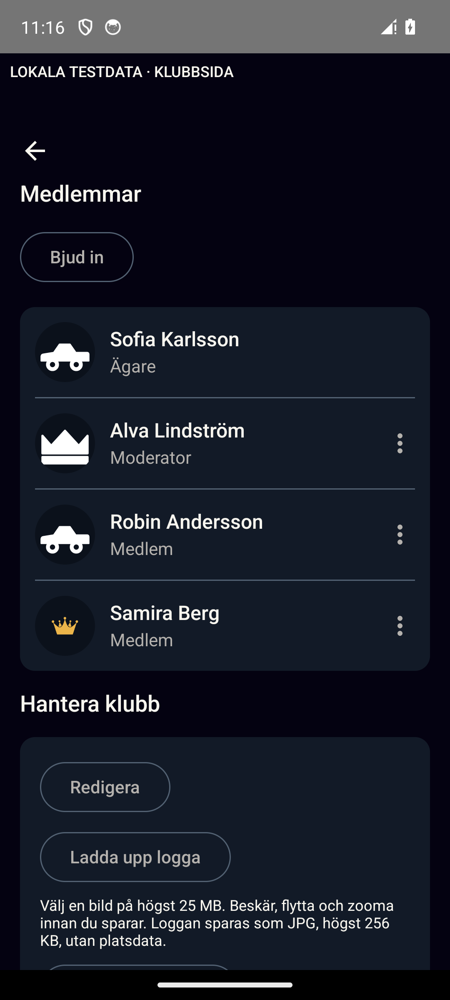

# Club page evidence

Final visual QA: **passed within the one-emulator local fixture limits**.
The fixture renders the actual production `SharedClubRoute`; no handcrafted
page preview, production account or new image asset is used.

| Section | Before | Accepted after |
| --- | --- | --- |
| Identity | [before-identity-dark.png](before-identity-dark.png): gold reading text | [after-identity-dark.png](after-identity-dark.png): separated identity/intro and neutral reading text |
| Members | [before-members-dark.png](before-members-dark.png): no avatars, persistent management rows | [after-members-dark.png](after-members-dark.png): compact avatar/name/role rows with contextual overflow |

Baseline code is `6756e8f`, app implementation is
`4f7d48efb612084780d3921dd047a11b7e2d101d`. Both after files are byte-for-byte
copies from `/home/sebmccayen/Downloads/CarCommunity-live-club-qa-20261030/settled-window-20261030/`:
`01-identity-dark-sv-1_0.png` and `04-members-upper-dark-sv-1_0.png`.
They are 1080x2400 full-window captures including Android system bars; before
files are 1080x2200 Compose content. Compare app content, not system chrome.
The before caption intentionally changes to neutral local-test-data copy after.

The independent adb members image is valid corroborating evidence. The earlier
claim that its banner/back arrow were missing is withdrawn: the native-coordinate
RGB crop `(15,140,1050,410)` is byte-identical across native-window, adb-paused and
settled-window members images. The selected representative remains settled-window.
Independent adb statistics/calendar and native members states resolve the initial
capture concern; no product UI bug was found. No persistent capture corruption or
specific graphics cause is established; see [design-qa.md](design-qa.md).

Parent validation: 131/131 filtered JVM, eleven actual native behavior tests,
lint/debug/test APKs; twenty original 1.0/2.0 captures plus the narrow native
window diagnostic. The final diagnostic test APK built in 38s; settled capture
passed one test. No agent Gradle/emulator run.

The fixture supports `clubPageCaptureRun`, `clubPageLocale`, `clubPageFontScale`,
`clubPageCaptureMode=window` (default is Compose export), and optional comma-separated
`clubPagePauseAt` state names. Native mode waits 250ms for the compositor; named
pauses write `club-page-paused.txt` under app external files and wait eight seconds
for parent's independent adb capture. These seams exist only in androidTest.

No production Firebase/Storage round trip, TalkBack, physical phone, second
device or release/deployment certification is claimed. External XML files were
not parseable and are not semantic evidence. Parent recovered a cold-boot System
UI ANR before the accepted baseline; the rejected first light identity is excluded.
