# Android: förhandsvisning av designetapp 2

Riktiga Android/Compose-vyer med **lokala testdata**, inte redigerade mockuper.
Varje bild har en synlig testdatamärkning. Inga riktiga medlemskonton, köp eller
platsdelningar skapades för dessa bilder. Appens ordinarie bilder används vid
riktig körning; här visas de inbyggda reservikonerna eftersom testdata saknar foton.

- Appkod: `7c2e64deecdbabd44b34dd964c2591ecced6e9d6` (Android, före dokumentationscommit).
- [CI-körning 40188008306](https://github.com/SebMcCayen/carcommunity/actions/runs/40188008306).
- Artefakt: `android-redesign-captures`, ID `12597037490`, mappen
  `attempt-1/carcommunity-redesign/wave2-dark/`.
- Android 14/API 34, 320 × 640 bildpunkter, mörkt tema, normal textstorlek.
  Appsträngar på engelska, uttryckligt svenskt testinnehåll. Ingen verifierad
  390-dp-, svensk-, ljust-tema- eller stor-text-körning representeras här.
- Original-PNG:erna är kopierade oförändrade från artefakten. Filernas SHA-256
  finns i [manifest.json](manifest.json). Samtliga öppnades och kontrollerades.

Detta är tolv komponenttillstånd. Navigationens hela appskal visas inte runt
varje testvy. Bilderna bevisar inte riktiga kartplattor, GPS, Firebase-konton,
Play-betalningar eller samtliga 84 konceptvyer. Ingen ny version har publicerats.
Se [verifieringslistan](../../android-redesign-validation.md) för testresultat och
kvarvarande enhetskontroller.

| Chatt                                     | Driver                                  | Driver: detalj                                             |
| ----------------------------------------- | --------------------------------------- | ---------------------------------------------------------- |
| 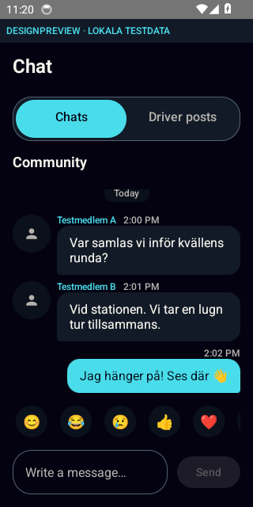 | 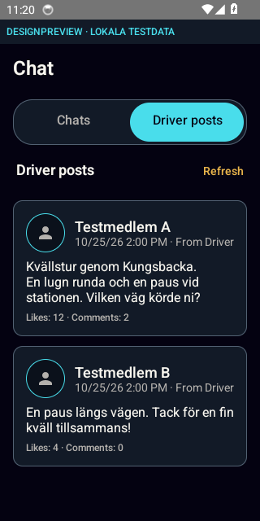 | 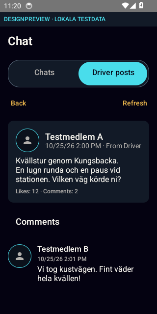 |

| Event                              | Event: detalj                             | Kronjakt                                 |
| ---------------------------------- | ----------------------------------------- | ---------------------------------------- |
| 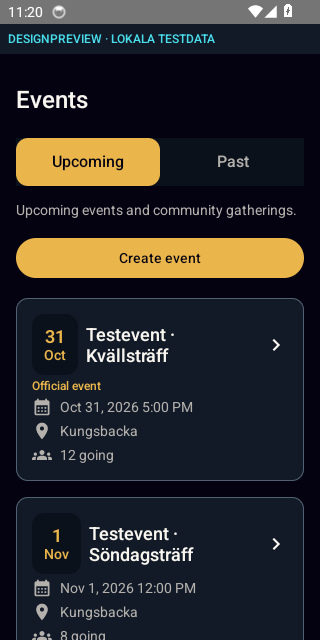 | 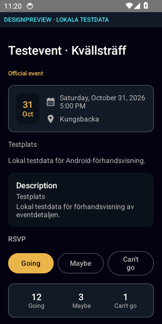 | 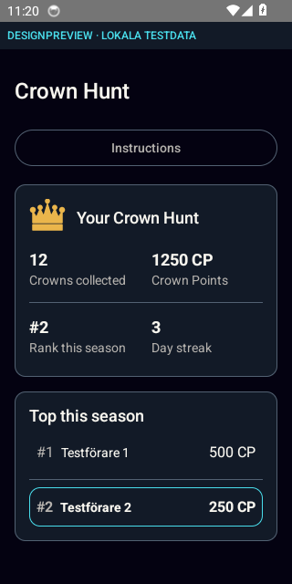 |

| Garage                                             | Profil                           | Inställningar                             |
| -------------------------------------------------- | -------------------------------- | ----------------------------------------- |
| 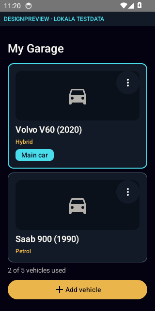 | 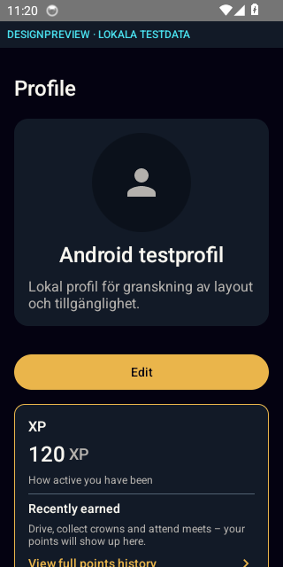 | 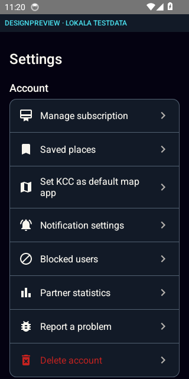 |

| Medlemskap                                   | Vald plats                                    | Live-delning                                             |
| -------------------------------------------- | --------------------------------------------- | -------------------------------------------------------- |
| 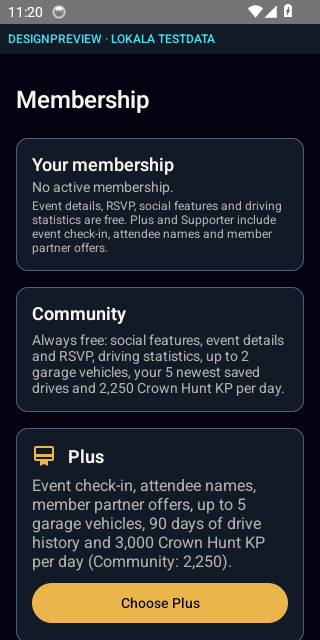 | 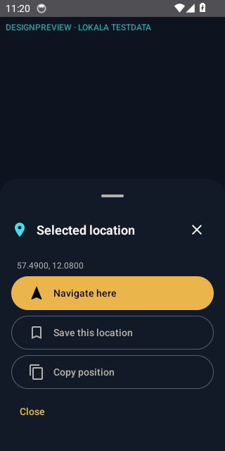 | 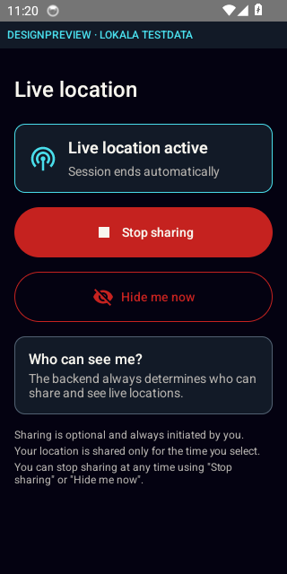 |
